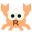
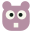

# Neon Moss

A Zed theme with almost-black green backgrounds and soft, bright syntax colors inspired by Monokai. Coral keywords, lime functions, pale yellow strings, cyan types and lavender constants keep the code easy to scan.

By XOzymandiasz.

## Preview

Open [Zed Theme Builder](https://zed.dev/theme-builder) on a desktop browser. Choose **Import > From File** and select [themes/neon-moss.json](themes/neon-moss.json) from this repository to preview the palette before installing it.

## Install

Clone or download this repository, then run the installer from its root.

Windows (PowerShell):

```powershell
.\install.ps1
```

macOS and Linux:

```sh
sh ./install.sh
```

The scripts copy `themes/neon-moss.json` to Zed's themes directory. Running them again replaces that file with the version in this repository.

Restart Zed and choose `Neon Moss` in the theme selector.

### Manual installation

Copy `themes/neon-moss.json` into:

| System | Folder |
| --- | --- |
| Windows | `%APPDATA%\Zed\themes` |
| macOS / Linux | `~/.config/zed/themes` |

On macOS and Linux, use `$XDG_CONFIG_HOME/zed/themes` if you have set `XDG_CONFIG_HOME`. Create the folder if needed.

You can also load this repository through Zed's `zed: install dev extension` command. Select the repository folder, then choose Neon Moss in the theme selector.

## File icons

The SVG artwork is in `icons/`:

| Preview | File | Design |
| --- | --- | --- |
|  | `folder.svg` | Green folder |
|  | `rust.svg` | Peach crab with a toothed shell and an R |
|  | `go.svg` | Cyan gopher |
|  | `json.svg` | Yellow braces |
|  | `go-mod.svg` | Pink gopher for `go.mod` |
|  | `go-sum.svg` | Muted pink gopher for `go.sum` |

These are the selected designs. Zed icon-theme configuration and filename mappings have not been added yet, so the installers currently install only the color theme.

The Rust icon is adapted from [Catppuccin Icons](https://github.com/catppuccin/vscode-icons). Its upstream MIT license is included in [icons/LICENSE-catppuccin](icons/LICENSE-catppuccin); [icons/SOURCES.md](icons/SOURCES.md) records the source and changes.

## Rust attribute colors

The theme assigns amber (`#FFD08A`) to the `attribute` and `preproc` styles. Whether a name uses those styles depends on the language's highlighting rules.

For Rust, enable semantic highlighting and add token rules to your Zed `settings.json`:

```json
{
  "languages": {
    "Rust": { "semantic_tokens": "combined" }
  },
  "global_lsp_settings": {
    "semantic_token_rules": [
      { "token_type": "builtinAttribute", "foreground_color": "#FFD08A" },
      { "token_type": "attribute", "foreground_color": "#FFD08A" },
      { "token_type": "derive", "foreground_color": "#FFD08A" }
    ]
  }
}
```

Merge these entries with your existing settings. The installers only copy the theme file; they do not edit your settings.

Open a Rust file in a Cargo project with rust-analyzer running. If needed, run `editor: restart language server`. Token names can vary with the language server. Use `dev: open highlights tree view` to inspect a token if a rule does not apply.

The web Theme Builder may classify Rust attribute names as variables, so its preview can differ from Zed with semantic highlighting enabled.

## Edit the palette

Colors live in `themes/neon-moss.json`. Edit `style` for the interface and `style.syntax` for code, then rerun the installer.

- [Zed themes](https://zed.dev/docs/themes)
- [Semantic tokens](https://zed.dev/docs/semantic-tokens)
