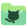
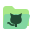
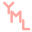
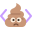
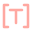

# Neon Moss

A Zed theme with almost-black green backgrounds and soft, bright syntax colors inspired by Monokai. Coral keywords, lime functions, pale yellow strings, cyan types and lavender constants keep the code easy to scan.

By XOzymandiasz.

## Preview

Open [Zed Theme Builder](https://zed.dev/theme-builder) on a desktop browser. Choose **Import > From File** and select [themes/neon-moss.json](themes/neon-moss.json) from this repository to preview the palette before installing it.

## Install

Clone or download this repository, then run the installer from its root.

Windows (PowerShell):

```powershell
.\install.ps1
```

macOS and Linux:

```sh
sh ./install.sh
```

The scripts copy `themes/neon-moss.json` to Zed's themes directory. Running them again replaces that file with the version in this repository.

Restart Zed and choose `Neon Moss` in the theme selector.

### Manual installation

Copy `themes/neon-moss.json` into:

| System | Folder |
| --- | --- |
| Windows | `%APPDATA%\Zed\themes` |
| macOS / Linux | `~/.config/zed/themes` |

On macOS and Linux, use `$XDG_CONFIG_HOME/zed/themes` if you have set `XDG_CONFIG_HOME`. Create the folder if needed.

You can also load this repository through Zed's `zed: install dev extension` command. Select the repository folder, then choose Neon Moss in the theme selector.

## File icons

The SVG artwork is in `icons/`:

| Preview | File | Design |
| --- | --- | --- |
|  | `folder.svg` | Rounded green folder |
|  | `rust.svg` | Filled peach crab with large eyes, a finely toothed shell and an R |
|  | `go.svg` | Cyan gopher |
|  | `json.svg` | Purple rounded tile with dark braces |
|  | `go-mod.svg` | Pink gopher for `go.mod` |
|  | `go-sum.svg` | Muted pink gopher for `go.sum` |
|  | `sql-lettering.svg` | Blue SQL lettering on a transparent background |
|  | `sql-up-lettering.svg` | Blue SQL lettering with a lime up arrow |
|  | `sql-down-lettering.svg` | Blue SQL lettering with a coral down arrow |
|  | `markdown-lettering.svg` | Mint M and down arrow on a transparent background |
|  | `readme-lettering.svg` | Green R on a transparent background for README files |
|  | `agents.svg` | Peach robot with green eyes for AGENTS files |
|  | `gitignore.svg` | Peach Git tile with a minus badge for `.gitignore` |
|  | `docker.svg` | Blue whale with containers for Dockerfile |
|  | `dockerignore.svg` | Whale with a gray minus badge for `.dockerignore` |
|  | `folder-github.svg` | Green `.github` folder with a cat emblem |
|  | `folder-github-open.svg` | Open `.github` folder |
|  | `yaml-lettering.svg` | Coral indented Y, M and L on a transparent background for `.yml` and `.yaml` |
|  | `xml.svg` | Sad poop with lavender angle brackets for `.xml` |
|  | `folder-target.svg` | Orange `target` folder |
|  | `folder-target-open.svg` | Open orange `target` folder |
|  | `env.svg` | Lime key for `.env` |
|  | `env-template.svg` | Muted dashed key for `.env.example` and `.env.template` |
|  | `lock.svg` | Lavender padlock for lock files |
|  | `toml.svg` | Coral brackets and T for `.toml` |
|  | `cargo.svg` | Peach crate for `Cargo.toml` |

Install the color theme and file icons together through Zed:

1. Open the command palette and run `zed: install dev extension`.
2. Select this repository's root folder, which contains `extension.toml`.
3. Choose `Neon Moss` as the color theme.
4. Set your icon theme to `Neon Moss Icons` in Zed settings:

```json
{
  "icon_theme": "Neon Moss Icons"
}
```

The icon theme maps `.rs`, `.go`, `.json`, `.jsonc`, `.sql`, `.yml`, `.yaml` and `.xml`, with separate gophers for `go.mod` and `go.sum`. SQL migrations use arrow variants for `up.sql` and `down.sql`, including filenames ending in `.up.sql` or `.down.sql`. Markdown files use mint M and arrow lettering; README and AGENTS files have their own icons. It also includes closed and open folders and a default file icon. Other file types use the default icon.

The PowerShell and shell installers above still copy only the color theme. Use the dev extension installation for file icons.

The Rust icon is adapted from [Catppuccin Icons](https://github.com/catppuccin/vscode-icons). Its upstream MIT license is included in [icons/LICENSE-catppuccin](icons/LICENSE-catppuccin); [icons/SOURCES.md](icons/SOURCES.md) records the source and changes.

### Update the icons

After pulling changes or editing the SVG files, run `zed: rebuild dev extension` from the command palette and select Neon Moss if prompted. Then run `zed: reload extensions`. If the icons still show the previous version, fully quit and reopen Zed. Check that `icon_theme` is set to `Neon Moss Icons`.

## Rust attribute colors

The theme assigns amber (`#FFD08A`) to the `attribute` and `preproc` styles. Whether a name uses those styles depends on the language's highlighting rules.

For Rust, enable semantic highlighting and add token rules to your Zed `settings.json`:

```json
{
  "languages": {
    "Rust": { "semantic_tokens": "combined" }
  },
  "global_lsp_settings": {
    "semantic_token_rules": [
      { "token_type": "builtinAttribute", "foreground_color": "#FFD08A" },
      { "token_type": "attribute", "foreground_color": "#FFD08A" },
      { "token_type": "derive", "foreground_color": "#FFD08A" }
    ]
  }
}
```

Merge these entries with your existing settings. The installers only copy the theme file; they do not edit your settings.

Open a Rust file in a Cargo project with rust-analyzer running. If needed, run `editor: restart language server`. Token names can vary with the language server. Use `dev: open highlights tree view` to inspect a token if a rule does not apply.

The web Theme Builder may classify Rust attribute names as variables, so its preview can differ from Zed with semantic highlighting enabled.

## Edit the palette

Colors live in `themes/neon-moss.json`. Edit `style` for the interface and `style.syntax` for code, then rerun the installer.

- [Zed themes](https://zed.dev/docs/themes)
- [Semantic tokens](https://zed.dev/docs/semantic-tokens)
